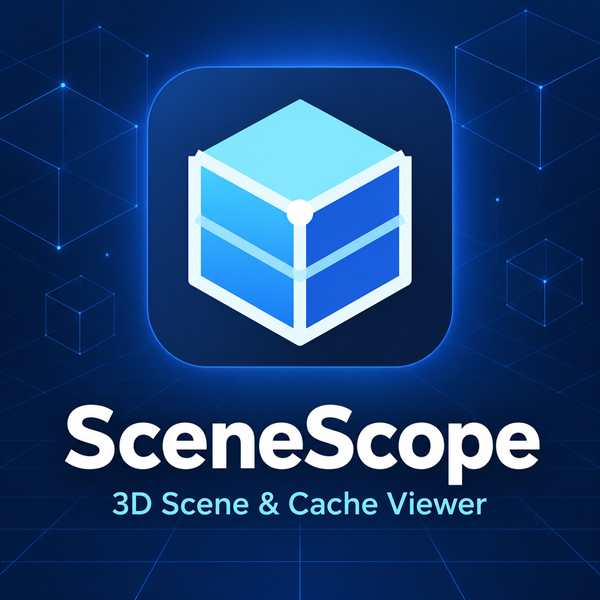

# SceneScope

**Inspect 3D scenes, animation and simulation caches on Windows.**
SceneScope is a fast viewer for USD, Alembic, FBX/OBJ and the cache formats used in
VFX and motion-graphics pipelines. It opens files read-only, shows what is really in
them, and never rewrites your sources.

*Visionneuse Windows pour scènes 3D, animations et caches de simulation. Les fichiers
sont ouverts en lecture seule. Version française plus bas.*



## Download

**Current version: 0.1.0-rc.24 (preview)** — free, no account, no telemetry.

- **Installer:** [SceneScope-Setup-rc24.exe](https://github.com/VictorBurtman/scenescope-releases/releases/download/v0.1.0-rc.24/SceneScope-Setup-rc24.exe) (680 MB)
- **Release page, checksums, notices and sources:** [v0.1.0-rc.24](https://github.com/VictorBurtman/scenescope-releases/releases/tag/v0.1.0-rc.24)
- **SHA-256:** `cf9c60978d5baa864283c1a091e8fb3a737f9de61f661976a930d2a9048b31d0`

Check it in PowerShell before running:

```powershell
Get-FileHash .\SceneScope-Setup-rc24.exe -Algorithm SHA256
```

### Install

1. Close SceneScope if it is running.
2. Run `SceneScope-Setup-rc24.exe`. It installs for the current user (no administrator
   rights) and includes everything it needs: Python, Qt, OpenUSD and MaterialX — nothing
   else to install.
3. An existing installation is updated in place; your preferences are kept and the
   previous version is retained for recovery.

The installer is **not code-signed** (Authenticode NotSigned), so Windows SmartScreen may
show a warning: choose *More info → Run anyway* after checking the SHA-256 above.

### Requirements

- Windows 11, 64-bit.
- A GPU and driver providing an OpenGL 4.5 compatibility context.
- About 8 GB of free disk space is prudent while installing (the installed application
  is ~2.6 GB); memory needs depend on your scenes.

Only an NVIDIA RTX 3080 Ti system has been qualified so far. Other GPUs, clean/offline
machines and network shares are still being validated — please report what you find.

## What it does

- **Formats:** USD (`.usd .usda .usdc .usdz`), Alembic (`.abc`), FBX, OBJ, MaterialX
  (`.mtlx`), OpenVDB, Houdini BGEO, XMesh, tyCache, PRT/PDC particles, Mantaflow UNI,
  Field3D and Bifrost caches. Support varies by exporter and source data.
- **Inspect:** scene hierarchy, composition (layers, variants, payloads), properties and
  array browsers, shading graphs, dependencies and diagnostics.
- **View:** Storm viewport with lighting and HDRI, material presets, display modes, cameras,
  grid, selection, hide/isolate, data overlays (numeric, color, direction), lens effects
  (depth of field, motion blur, bloom).
- **Time:** timeline with visible range, loop, RAM cache and FPS control.
- English and French interface.

## License and terms

SceneScope is **free for personal, educational and professional use**, including studio
and commercial work, without seat limits. A [Gumroad contribution](https://victorburtman.gumroad.com/l/qgcdqp)
is optional and gives the same application and rights. Read the full [terms](TERMS.md).

The original application code is proprietary. Bundled third-party software keeps its own
licenses. Notices and library-replacement instructions are included in the installer.
The unchanged notice archive, `source-delivery-index.json` and **corresponding source/recipe
archives** remain available on the [rc.21 release](https://github.com/VictorBurtman/scenescope-releases/releases/tag/v0.1.0-rc.21).

## Support

Contact **victorburtman@gmail.com** with the version, system information and steps to
reproduce. SceneScope is a preview: support, schedule and response time are not guaranteed.

---

## Français

**SceneScope** ouvre en lecture seule des scènes USD, Alembic, FBX/OBJ et de nombreux
caches de simulation (VDB, BGEO, XMesh, tyCache, particules, Field3D, Bifrost) pour
inspecter leur contenu réel sans jamais modifier vos fichiers.

### Télécharger et installer

Version actuelle : **0.1.0-rc.24 (préversion)**, gratuite, sans compte ni télémétrie.

- **Installateur :** [SceneScope-Setup-rc24.exe](https://github.com/VictorBurtman/scenescope-releases/releases/download/v0.1.0-rc.24/SceneScope-Setup-rc24.exe) (680 Mo)
- **SHA-256 :** `cf9c60978d5baa864283c1a091e8fb3a737f9de61f661976a930d2a9048b31d0`

Fermez SceneScope s'il est ouvert, puis lancez l'installateur : il s'installe pour
l'utilisateur courant, sans droits administrateur, et contient tout le nécessaire. Une
installation existante est mise à jour sur place (préférences conservées, version
précédente gardée pour la récupération). Le programme n'est pas signé : Windows SmartScreen
peut afficher un avertissement (*Informations complémentaires → Exécuter quand même*)
après vérification de l'empreinte SHA-256.

**Prérequis :** Windows 11 64 bits, pilote graphique avec contexte OpenGL 4.5 en mode
compatibilité. Seule une machine NVIDIA RTX 3080 Ti a été qualifiée à ce jour.

### Licence

Usage gratuit, personnel comme professionnel (studio et projets commerciaux compris),
sans limite de postes ; la contribution Gumroad est facultative et ne change ni
l'application ni les droits. Voir les [conditions](TERMS.md). Le code original reste
propriétaire ; les composants tiers conservent leurs licences. Les notices et instructions
de remplacement des bibliothèques sont incluses dans l'installateur. Les archives de notices
et sources correspondantes inchangées restent disponibles sur la [release rc.21](https://github.com/VictorBurtman/scenescope-releases/releases/tag/v0.1.0-rc.21).

**Assistance :** victorburtman@gmail.com
